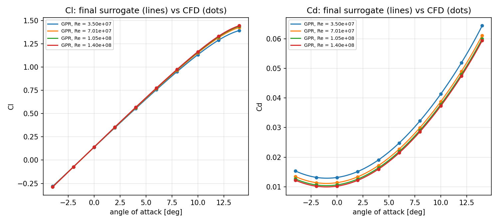
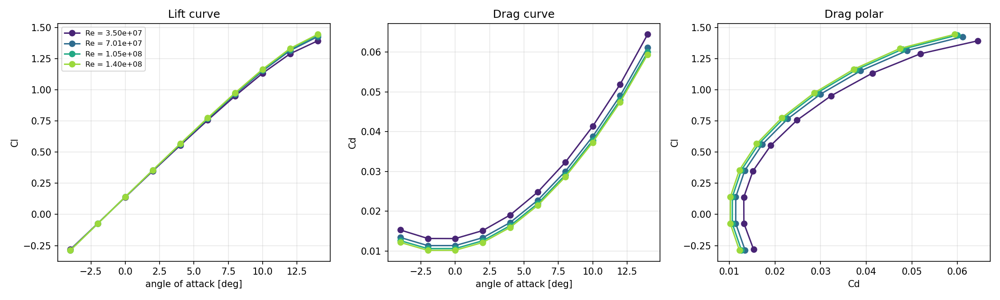
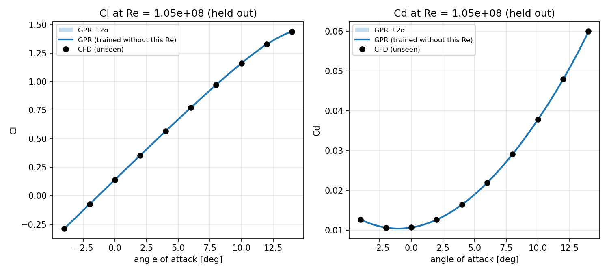

# CFD Surrogate Model for Airfoil Aerodynamics

> OpenFOAM parametric sweep of a 2D airfoil + machine-learning surrogate that predicts lift (Cl) and drag (Cd) in milliseconds instead of running a new simulation.



**Status:** CFD sweep and surrogate complete (40 OpenFOAM runs). Next: interactive web demo.

## Problem
Production-grade RANS simulations take minutes to hours each, and design studies need thousands of evaluations.
A surrogate model trained on a small set of CFD runs can answer "what are Cl and Cd at this
angle of attack and Reynolds number?" almost instantly.

## Method
1. **CFD:** OpenFOAM `simpleFoam`, Spalart-Allmaras turbulence model, 2D cambered airfoil from the OpenFOAM `airFoil2D` tutorial (chord 35.05 m, about 18 % thick, ~10,700 cells)
2. **Sweep:** automated runs over angle of attack and freestream velocity (Reynolds number), Cl/Cd extracted with the `forceCoeffs` function object
3. **Surrogate:** inputs (angle of attack, log10 Re) -> Cl, Cd. Gaussian Process Regression (anisotropic RBF kernel) vs a small neural network (MLP, 2x32 tanh), both scikit-learn
4. **Validation:** three tests on unseen CFD cases: a whole Reynolds number held out (U = 30 m/s), whole angles held out (2, 6, 10 deg at all speeds), and leave-one-out

## Results

**CFD sweep:** 40 cases, alpha = -4 to 14 deg, U = 10 to 40 m/s (Re = 3.5e7 to 1.4e8), about 5 s per case on a laptop.
33 cases reached the residual target; the other 7 (alpha 12-14 deg) have force coefficients steady to < 1e-4 over the last 50 iterations and are kept.



| Re | dCl/dalpha [1/rad] | zero-lift angle [deg] | max L/D (at alpha) |
| --- | --- | --- | --- |
| 3.5e7 | 5.96 | -1.32 | 30.5 (6 deg) |
| 7.0e7 | 6.04 | -1.31 | 33.7 (6 deg) |
| 1.05e8 | 6.08 | -1.31 | 35.2 (6 deg) |
| 1.4e8 | 6.10 | -1.31 | 36.1 (6 deg) |

Lift slope close to thin-airfoil theory (2 pi = 6.28 /rad); drag falls as Re rises, as expected.

**Surrogate accuracy on unseen cases (mean absolute error):**

| Test | GPR Cl | MLP Cl | GPR Cd | MLP Cd |
| --- | --- | --- | --- | --- |
| Re held out (U = 30 m/s) | 0.00016 | 0.0073 | 0.00003 | 0.00006 |
| Angles held out (2, 6, 10 deg) | 0.00062 | 0.0062 | 0.00002 | 0.00012 |
| Leave-one-out | 0.00015 | 0.0104 | 0.00001 | 0.00014 |

With 40 samples, GPR is about 10x more accurate than the MLP and also gives an uncertainty band. A prediction takes about 1 ms instead of a new CFD run.



**Lesson learned:** with unbounded kernel length scales the GPR fitted the grid points exactly but dipped between them (e.g. Cl = 0.63 at 7 deg instead of about 0.87). Leave-one-out did not reveal it; plotting the final model on a fine grid did. Length scales are now bounded and the dense-curve plot is part of the pipeline.

## How to run
```bash
# requires Docker with an OpenFOAM image (tested with OpenFOAM v2512)
./scripts/fetch_template.sh     # copy the base case from the Docker image
./scripts/run_baseline.sh       # one reference run
python3 scripts/sweep.py        # 40 runs: alpha -4..14 deg x U 10..40 m/s -> data/sweep_results.csv
pip install -r requirements.txt
python3 scripts/analyze.py              # aerodynamic curves + lift slope table
python3 scripts/train_surrogate.py      # GPR vs MLP, validation, figures
python3 scripts/predict.py --alpha 7 --speed 25
```

## Repository structure
```
cases/      OpenFOAM case template
scripts/    Docker wrapper, run and sweep scripts
src/        Python package: parsing, dataset, models
notebooks/  exploration and figures
data/       sweep results (CSV, included)
results/    figures and metrics used in this README
```

## Limitations
- Coarse tutorial mesh, chosen so a full sweep runs in minutes on a laptop; absolute Cl/Cd are mesh-dependent
- Steady RANS: results near and beyond stall are less reliable; the sweep stops at 14 deg, before stall
- Surrogate is valid only inside the sampled range (alpha -4..14 deg, Re 3.5e7..1.4e8)

## Author
Matt — aerospace engineer (CFD, aerodynamics) working on machine learning for fluid mechanics. Bremen, Germany.

## License
MIT
